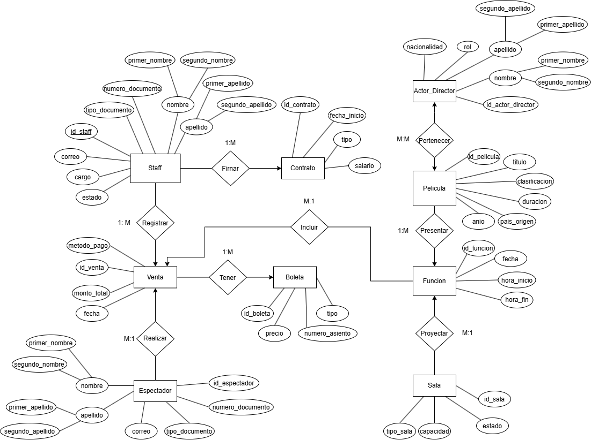

# Modelo entidad–relación · Cine Umbral

- [Abrir o descargar el diagrama](proyecto_cine-modelo-entidad-relacion.drawio.png)
- [Consultar el modelo relacional en 3FN](../modelo-relacional/README.md)

## Lógica representada

El modelo conserva las entidades de operación solicitadas y añade **Pelicula** y **Boleta**. Pelicula permite asociar cada función con la obra que se proyecta. Boleta representa el asiento individual vendido; una venta puede contener varias boletas.

Actores y directores se relacionan con películas en una relación muchos a muchos. El atributo de rol diferencia su participación. Contrato representa un vínculo laboral de un integrante del staff con Cine Umbral y se clasifica por tipo de contrato; no representa un contrato de producción cinematográfica.

Una función presenta una película en una sala. Una venta se asocia con un espectador y una función, y el registro de staff es opcional para permitir la compra digital. Cada boleta guarda el tipo y el precio aplicado.

## Paso al modelo relacional

En el diagrama conceptual, el tipo aparece como atributo de Boleta. Al normalizar, se separa en el catálogo **Tipo_Boleta**, al que referencia cada boleta. Esta separación mantiene el tipo de ticket como dato administrado y reutilizable. También se normalizan los tipos de documento, cargos, estados, métodos de pago y clasificaciones en sus catálogos.
