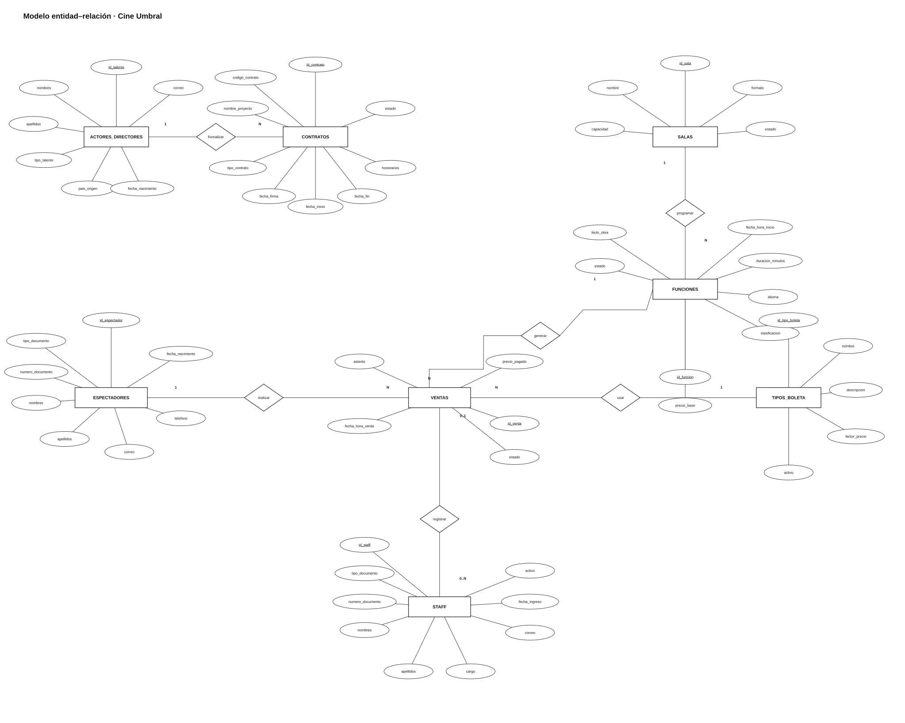

# Modelo entidad–relación · Cine Umbral

- [Ver el diagrama SVG](modelo-er.svg)
- [Editar el diagrama en draw.io](modelo-er.drawio)
- [Consultar el modelo relacional en 3FN](../modelo-relacional/README.md)

El diagrama presenta las ocho entidades de la guía, sus atributos, claves identificadoras y cardinalidades con notación Chen. Las relaciones se nombran con verbos en infinitivo: formalizar, corresponder, programar, realizar, usar, generar y registrar.

**Regla de negocio representada:** un contrato formaliza la participación de un actor o director invitado en una función específica. Cada contrato corresponde a una sola persona y a una sola función; una persona o una función puede aparecer en varios contratos. Esto permite registrar más de un invitado en un cineforo sin convertir el cine en productor de las películas exhibidas.
