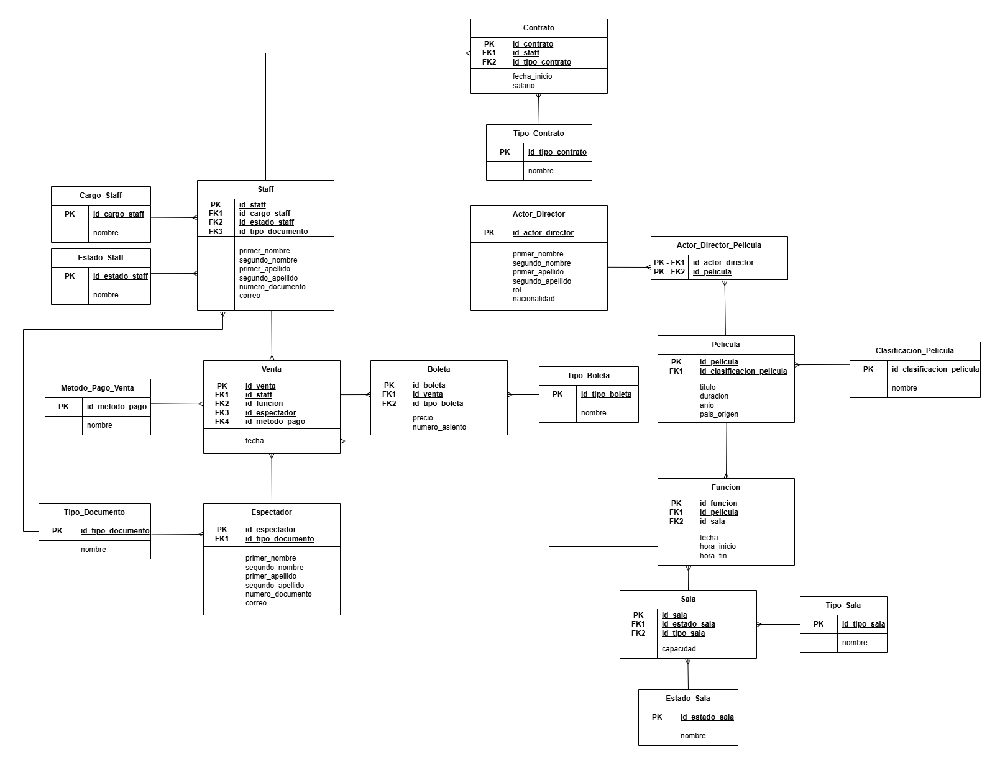

# Modelo relacional en tercera forma normal · Cine Umbral

- [Abrir o descargar el diagrama](modelo-relacional.drawio.png)
- [Consultar las relaciones, claves y justificación de 3FN](modelo-relacional-3fn.md)
- [Ver el modelo entidad–relación](../modelo-er/README.md)

## Decisiones de modelado

La propuesta conserva las ocho entidades base y añade **Pelicula** y **Boleta**: Pelicula permite programar las funciones, y Boleta registra individualmente cada asiento vendido. **Tipo_Boleta** es un catálogo separado que referencia las boletas.

La venta funciona como encabezado de la operación: referencia un espectador, una función, el método de pago y, cuando aplica, el empleado que la registra. El detalle de boletas permite vender varios asientos en una venta. El precio se guarda por boleta; el total de la venta se calcula sumando esos precios y no se duplica en una columna.

Los contratos corresponden al vínculo laboral del staff. Actores y directores se relacionan con películas mediante la tabla asociativa Actor_Director_Pelicula.

## Organización del modelo

El diagrama muestra **19 tablas**: las ocho entidades base, Pelicula y Boleta, ocho catálogos complementarios y la tabla asociativa Actor_Director_Pelicula. Tipo_Boleta cuenta entre las ocho entidades base y se representa como catálogo en el modelo normalizado. La documentación complementaria enumera sus claves foráneas, cardinalidades y reglas de integridad.
