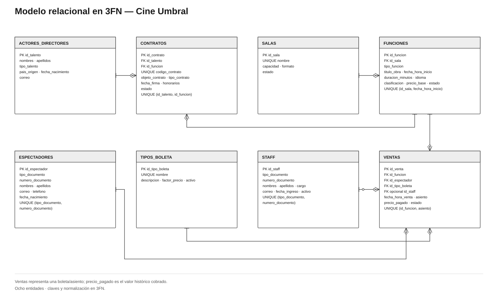

# Modelo relacional en tercera forma normal · Cine Umbral

El diagrama presenta las ocho tablas, sus atributos, claves primarias, claves foráneas y restricciones únicas. La documentación complementaria especifica tipos previstos para PostgreSQL, reglas de integridad y la justificación de 3FN.

Las relaciones usan pata de gallo: círculo para opcionalidad, barra para obligatoriedad y bifurcación para muchos. Las claves foráneas están en la tabla del lado N.

- [Abrir el diagrama SVG](modelo-relacional-3fn.svg)
- [Editar la fuente en draw.io](modelo-relacional-3fn.drawio)
- [Consultar relaciones, restricciones y justificación 3FN](modelo-relacional-3fn.md)

## Decisiones del modelo

- Se conservan exactamente las ocho entidades solicitadas en la guía.
- Una fila de `VENTAS` representa una boleta y un asiento para una función.
- `VENTAS.precio_pagado` guarda el importe histórico cobrado.
- `VENTAS.id_staff` es opcional para permitir ventas digitales.
- `FUNCIONES` guarda el título de la obra porque el alcance exigido no incluye una tabla `PELICULAS`.
- La identidad del negocio se limita a la exhibición de películas comerciales; las entidades de talento y contratos se mantienen por exigencia académica.
